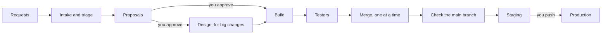

# Software Factory

Software Factory runs a team of AI agents on one product's code. Each agent is a Claude Code session with one job:
plan, design, build, review or test. Together they turn requests into tested changes and put each change on a staging
copy of your app. You choose what they work on, and only you ship a change to your users.

## How it works

Think of a small factory. Orders come in at one end. Workers sort them, plan the work, build it and inspect it.
Finished work waits on a shelf until you send it out. Here the workers are Claude agents, the shelf is staging, and
you send work out with the **Push to prod** button.



1. **Requests come in** from you, your users' reports, new errors in production, a Discord channel you connect, or
   the agents themselves.
2. **Agents sort them.** An intake agent turns an urgent request into a task within minutes. A triage agent sorts
   the rest into tasks, in batches.
3. **The orchestrator proposes work.** This lead agent picks the tasks that bring you closest to the goal you wrote
   in `GOAL.md`. You see up to three proposals at a time, each with a picture and a reason.
4. **You approve.** Nothing starts without your approval, except a fix for production when it is clearly down.
5. **Big changes get a design first.** A designer agent writes a spec, and critic agents review it. For the largest
   changes, you read the spec and press **Go**.
6. **An implementer builds it** on its own branch, with its own running copy of your app. It writes the tests first.
7. **Testers check it.** Tester agents use the running app the way a person would, in a real browser. Which testers
   run depends on what the change touches. Every one of them must pass on the final version.
8. **Branches merge one at a time.** Each branch merges only after it passes the standard checks.
9. **The main branch is checked again.** Regression testers replay the saved scenarios that the new merges could
   break. When a merge breaks one, the factory finds that merge and reverts it.
10. **Staging runs the newest work.** Staging is a full copy of your app on the server.
11. **You ship.** Press **Push to prod** to build and deploy the newest commit that passed its checks. **Push back**
    returns production to the commit it ran before.

[docs/how-it-works.md](docs/how-it-works.md) describes the agents, the parts and the limits.
[docs/dev-cycle.md](docs/dev-cycle.md) gives every rule of each step.

## Before you use it

- **Agents have wide powers.** Agent sessions run with every tool allowed and no permission prompts. The guard, a
  hook on every tool call, is the one wall around them. The code an agent writes runs on the server's Docker, so it
  can reach production and its data. Know that before your product has real users.
- **One owner, one product, one server.** The factory runs on the same server as your production app.
- **Your product takes a fixed shape,** which [docs/repo-shape.md](docs/repo-shape.md) describes. The checks expect
  Python.
- **It relies on Claude Code's internals,** which no version promises to keep. So the agents use the copy of Claude
  Code that the install took from you, and that copy never updates itself.

## Get started

You need a server running Ubuntu 24.04, with a domain name for your product and one for the dashboard. You also
need a Claude account for the agents and an authenticator app. [What you need](docs/how-it-works.md#what-you-need)
lists the rest.

1. Give your product the [standard shape](docs/repo-shape.md).
2. From your laptop, in a clone of this repo, set up the server. `--dry-run` reads everything and changes nothing.
   [docs/server.md](docs/server.md) gives every option.

   ```bash
   python3 -m standard.server.setup --product <your product checkout> --dry-run
   python3 -m standard.server.setup --product <your product checkout>
   ```

3. On the server, install the factory. The install asks for what it needs as it goes.

   ```bash
   gh repo clone OmarSalimMoussa/software-factory && cd software-factory
   sudo python3 runtime/system/install.py --commit HEAD --repo <your product checkout>
   ```

4. Open the dashboard, sign in with the 6-digit code, and start the orchestrator from the Agents page.
5. Approve your first proposal on Home.

[docs/operate.md](docs/operate.md) covers daily use, upgrades and what to do when something goes wrong.
[docs/mcp.md](docs/mcp.md) shows how to connect Claude Code on your laptop to the factory.

## License

MIT, copyright (c) 2026 [Omar Salim Moussa](https://github.com/OmarSalimMoussa). See [LICENSE](LICENSE).
