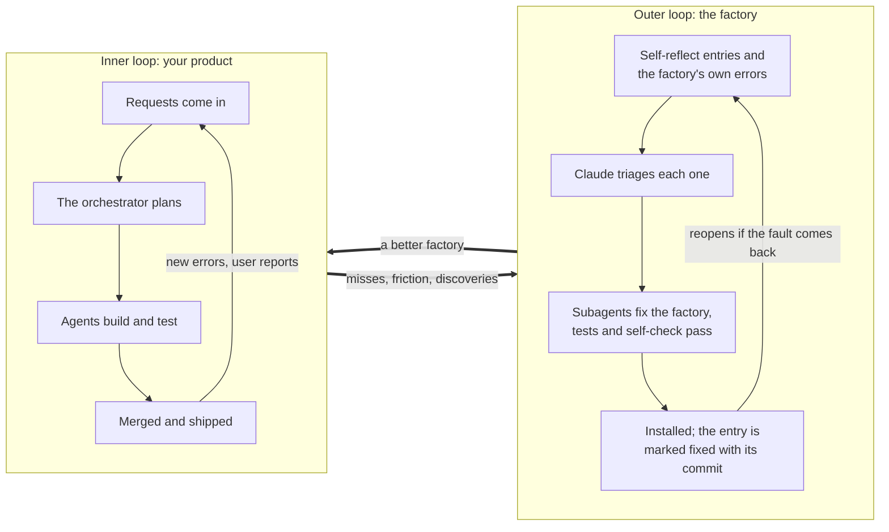
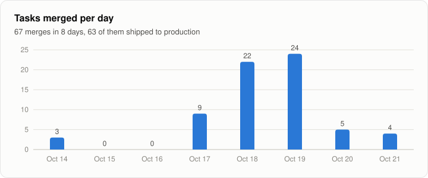
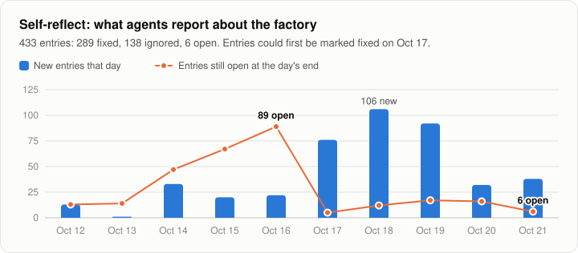
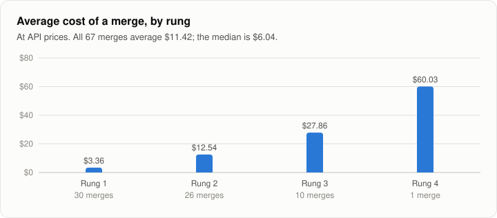
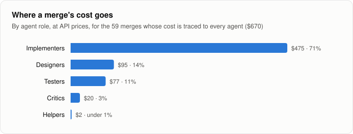
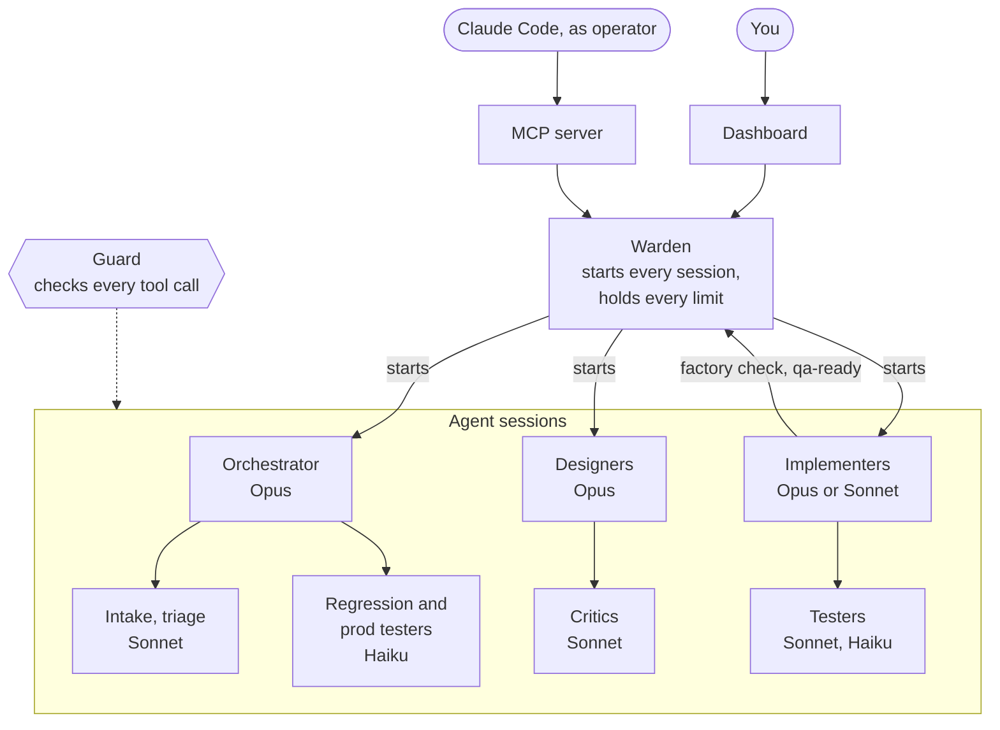

# Software Factory

Software Factory runs a team of AI agents on one product's code, and improves itself while it runs. Each agent is a
Claude Code session with one job: plan, design, build, review or test. Together they turn requests into tested
changes on a staging copy of your app. You choose what they work on, and only you ship a change to your users.

| 67 | 63 | $11.42 | 433 | 1,342 |
| :---: | :---: | :---: | :---: | :---: |
| tasks merged | shipped to production | average cost of a merge | Self-reflect entries, 427 closed | agent runs |

These numbers come from the factory's run on one product, through October 21, 2026. Dollars are at Anthropic's API
list prices, which the factory uses to price every model call. The agents ran on a Claude subscription, so the
dollars estimate the API cost; they are not the bill.

## Two loops

The factory runs two loops at once. In the inner loop, agents improve your product. In the outer loop, Claude
improves the factory, using what the agents report about their own work.



- **Agents report what goes wrong.** When a rule blocks good work, or a problem slips past, an agent says so in
  Self-reflect. The warden adds its own entries, such as a crash or an outage.
- **Claude fixes the factory from outside.** Agents never edit the factory. A Claude Code session, acting as
  operator, triages each entry. Subagents fix the code, and the fix must pass the factory's own standard checks.
- **Fixes are checked, not assumed.** Each entry is marked fixed with its commit. If the problem comes back, the entry
  reopens with a note naming the fix that did not hold.
- **The warden heals what it can alone.** It resumes crashed agents and restarts a silent orchestrator. It tells an
  outage from network trouble, and reverts a merge that breaks a saved test.

[docs/self-improvement.md](docs/self-improvement.md) explains each part of the loop.

## What it has done

<picture>
  <source media="(prefers-color-scheme: dark)" srcset="docs/charts/merges-per-day-dark.svg">
  
</picture>

<picture>
  <source media="(prefers-color-scheme: dark)" srcset="docs/charts/self-reflect-dark.svg">
  
</picture>

The median merge cost $6.04, because the orchestrator plans each task on the cheapest rung that can do it.

<picture>
  <source media="(prefers-color-scheme: dark)" srcset="docs/charts/merge-cost-by-rung-dark.svg">
  
</picture>

<picture>
  <source media="(prefers-color-scheme: dark)" srcset="docs/charts/merge-cost-by-role-dark.svg">
  
</picture>

[docs/cost-and-vitals.md](docs/cost-and-vitals.md) explains how cost, time and the machine's vitals are measured.

## How a change moves through it

1. **Requests come in** from you, your users' reports, production errors, a Discord channel, or the agents.
2. **Intake and triage agents** turn requests into tasks. An urgent request becomes a task within minutes.
3. **The orchestrator proposes** the tasks that bring you closest to the goal you wrote in `GOAL.md`.
4. **You approve.** Nothing starts without you, except a fix for production when it is clearly down.
5. **A designer writes a spec** for a big change, and critics review it until they find nothing new.
6. **An implementer builds it** on its own branch, with its own running copy of your app. It writes tests first.
7. **Testers use the app** in a real browser, at phone and desktop widths. Every required tester must pass.
8. **Branches merge one at a time,** each after it passes the standard checks.
9. **Regression testers recheck the main branch.** A merge that breaks a saved test scenario is found and reverted.
10. **Staging runs the newest work.** Press **Push to prod** to ship it, or **Push back** to undo the last push.

[docs/how-it-works.md](docs/how-it-works.md) describes the agents and the parts. [docs/dev-cycle.md](docs/dev-cycle.md)
gives every rule of each step.

## Before you use it

- **Agents have wide powers.** Agent sessions run with every tool allowed and no permission prompts. The guard, a
  hook on every tool call, is the one wall around them. The code an agent writes runs on the server's Docker, so it
  can reach production and its data. Know that before your product has real users.
- **One owner, one product, one server.** The factory runs on the same server as your production app.
- **Your product takes a fixed shape,** which [docs/repo-shape.md](docs/repo-shape.md) describes. The checks expect
  Python.
- **It relies on Claude Code's internals,** which no version promises to keep. So the agents use the copy of Claude
  Code that the install took from you, and that copy never updates itself.

## Get started

You need a server running Ubuntu 24.04, with a domain name for your product and one for the dashboard. You also
need a Claude account for the agents and an authenticator app. [What you need](docs/how-it-works.md#what-you-need)
lists the rest.

1. Give your product the [standard shape](docs/repo-shape.md).
2. From your laptop, in a clone of this repo, set up the server. `--dry-run` reads everything and changes nothing.
   [docs/server.md](docs/server.md) gives every option.

   ```bash
   python3 -m standard.server.setup --product <your product checkout> --dry-run
   python3 -m standard.server.setup --product <your product checkout>
   ```

3. On the server, install the factory. The install asks for what it needs as it goes.

   ```bash
   gh repo clone OmarSalimMoussa/software-factory && cd software-factory
   sudo python3 runtime/system/install.py --commit HEAD --repo <your product checkout>
   ```

4. Open the dashboard, sign in with the 6-digit code, and start the orchestrator from the Agents page.
5. Approve your first proposal on Home.

[docs/operate.md](docs/operate.md) covers daily use, upgrades and what to do when something goes wrong.
[docs/mcp.md](docs/mcp.md) shows how to connect Claude Code on your laptop to the factory.

## System design



The warden is a system service, and the only way an agent session starts. The guard is a hook that checks every tool
call of every agent before it runs. You act through the dashboard, and Claude Code takes the same actions through the
MCP server. Agents ask the warden for what they need with the `factory` command. Each role runs on the model that fits
it; the labels show the defaults.

## License

MIT, copyright (c) 2026 [Omar Salim Moussa](https://github.com/OmarSalimMoussa). See [LICENSE](LICENSE).
